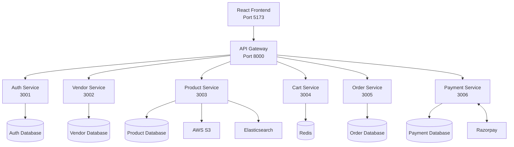
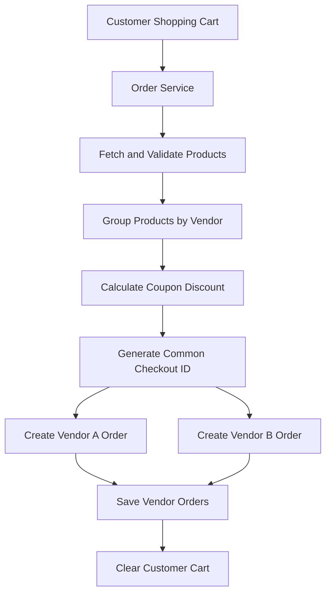
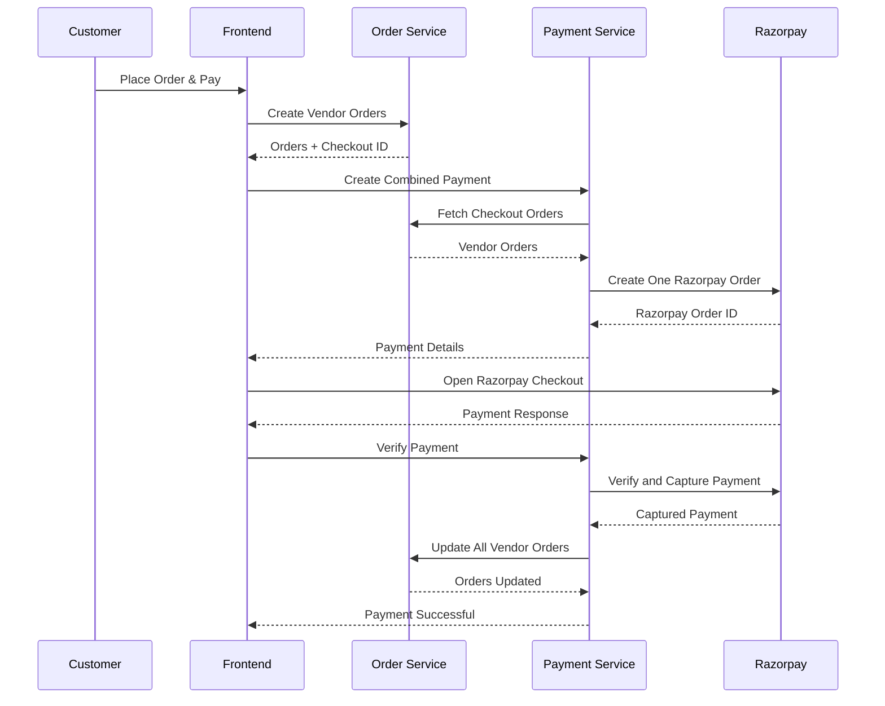
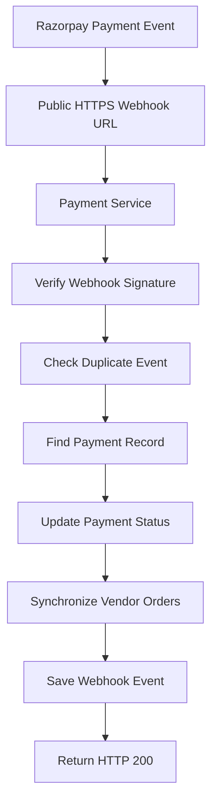
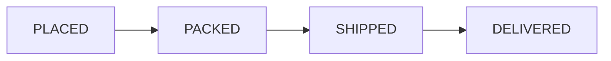

# Marketly — System Architecture

## 1. Project Overview

Marketly is a microservices-based multi-vendor e-commerce marketplace.

The platform allows multiple vendors to sell products while customers can browse products, manage shopping carts, apply coupons, and purchase products from multiple vendors through one combined Razorpay payment.

The system uses independent backend services connected through a centralized API Gateway.

## 2. High-Level Architecture



## 3. Microservices Responsibilities

### Auth Service
Port: 3001

Responsibilities:
- Customer registration and login.
- JWT authentication.
- HTTP-only cookie management.
- User role management.
- Logout and session handling.

Database: Auth MongoDB.

### Vendor Service
Port: 3002

Responsibilities:
- Vendor application submission.
- Vendor profile management.
- Admin approval and rejection.
- User role synchronization with Auth Service.

Database: Vendor MongoDB.

### Product Service
Port: 3003

Responsibilities:
- Product creation and management.
- Product image uploads.
- AWS S3 integration.
- Elasticsearch product search.
- Product filtering and sorting.
- Customer product reviews and ratings.
- Approved vendor verification.

Database: Product MongoDB.

External integrations:
- AWS S3.
- Elasticsearch.
- Vendor database for approved-vendor verification.

### Cart Service
Port: 3004

Responsibilities:
- Add products to cart.
- Update cart quantities.
- Remove products.
- Clear cart.
- Retrieve customer cart.

Storage: Redis.

Each authenticated customer maintains an individual shopping cart.

### Order Service
Port: 3005

Responsibilities:
- Multi-vendor checkout.
- Vendor-wise order creation.
- Coupon validation and redemption.
- Discount allocation.
- Order cancellation.
- Order tracking.
- Invoice generation.
- Internal payment-status synchronization.

Database: Order MongoDB.

### Payment Service
Port: 3006

Responsibilities:
- Razorpay order creation.
- Single-order payment.
- Combined multi-vendor payment.
- Payment signature verification.
- Vendor-wise commission calculation.
- Payment history.
- Admin payment analytics.
- Razorpay webhook processing.

Database: Payment MongoDB.

Collections:
- payments
- checkoutpayments
- webhookevents

External integration:
- Razorpay Test Mode.

## 4. Multi-Vendor Checkout Architecture

A customer can purchase products from different vendors in one checkout.

### Order Creation Flow



### Single Payment Flow



## 5. Payment Allocation

The combined payment is stored as one checkout payment record.

The payment contains:
- Common checkout ID.
- Multiple vendor order IDs.
- Customer ID.
- Combined payment amount.
- Razorpay order and payment IDs.
- Vendor-wise allocations.
- Platform commission.
- Vendor earnings.
- Payment status.

Commission is calculated on the combined payment and distributed proportionally across vendor allocations.

All monetary amounts are stored in paise.

**Important:** Calculated vendor earnings are internal accounting records. Actual bank payouts require a separate payout integration.

## 6. Razorpay Webhook Architecture



Supported events:
- payment.captured
- payment.failed

Webhook processing uses signature verification and event tracking to prevent duplicate processing.

## 7. Internal Service Communication

Internal service requests are used for trusted backend-to-backend communication.

Examples:

- Vendor Service updates user roles in Auth Service.
- Payment Service retrieves vendor orders from Order Service.
- Payment Service updates order payment statuses.
- Product Service verifies vendor approval.

Internal requests use configured service URLs and internal authentication keys where applicable.

## 8. Security Architecture

- JWT-based authentication.
- HTTP-only cookies.
- Role-based access control.
- Approved vendor authorization.
- Internal service authentication keys.
- Razorpay payment signature verification.
- Webhook signature verification.
- Environment-based secrets.
- CORS configuration with credentials.

## 9. External Integrations

| Technology | Purpose |
|---|---|
| AWS S3 | Product image storage |
| Elasticsearch | Product search and filtering |
| Redis | Cart caching |
| Razorpay | Online payment processing |
| Cloudflare Tunnel | Local webhook testing |

## 10. Order Lifecycle



Customers can cancel eligible unpaid orders.

Vendors manage the order lifecycle for their own orders.

## 11. Infrastructure and Ports

| Component | Port |
|---|---:|
| React Frontend | 5173 |
| API Gateway | 8000 |
| Auth Service | 3001 |
| Vendor Service | 3002 |
| Product Service | 3003 |
| Cart Service | 3004 |
| Order Service | 3005 |
| Payment Service | 3006 |
| Redis | 6379 |

## 12. Future Enhancements

- Automated vendor payouts using Razorpay Route.
- Production cloud deployment.
- Automated integration testing.
- Advanced marketplace analytics.
- Centralized logging and monitoring.
- Improved distributed transaction handling.
```
